[English](README.md) · **Deutsch**

# Computerfuchs

Ein Lerncomputer für Kinder von etwa 5 bis 15 Jahren, der im Browser läuft.
Computerfuchs simuliert einen freundlichen Desktop mit Fenstern, Taskleiste und
Start-Menü, und dieser Desktop wächst mit dem Kind. Eine Fünfjährige startet mit
großen Symbolen, die mit einem Klick aufgehen. Im Maustraining schaltet sie frei,
was ein echter Computer kann: Doppelklick, Fenster verschieben, Rechtsklick-Menü
und Fenster-Knöpfe. Ältere Kinder bekommen gleich den vollen Desktop. Das Ziel
ist das der Spielzeug-Lerncomputer, nur auf jedem alten Laptop: lernen, wie man
einen Computer bedient, und daran Mathe, Lesen und mehr üben.

**→ [technikweber.github.io/Computerfuchs](https://technikweber.github.io/Computerfuchs/)**

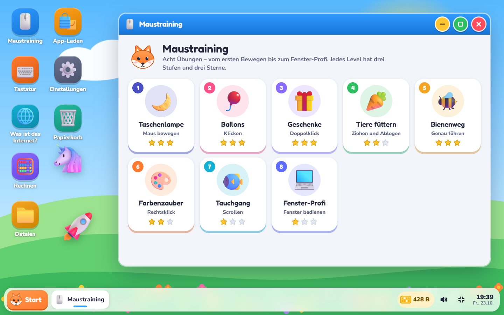

> Früher Prototyp, Version 0.3 entsteht gerade. Maustraining, Tastatur,
> Rechnen, „Was ist das Internet?“, Dateien und der App-Laden sind spielbar. Ein
> Malkasten, Buchstaben und mehr stehen im Fahrplan (siehe
> [Konzept](docs/CONCEPT.de.md)).

## So sieht es aus

<table>
  <tr>
    <td width="50%">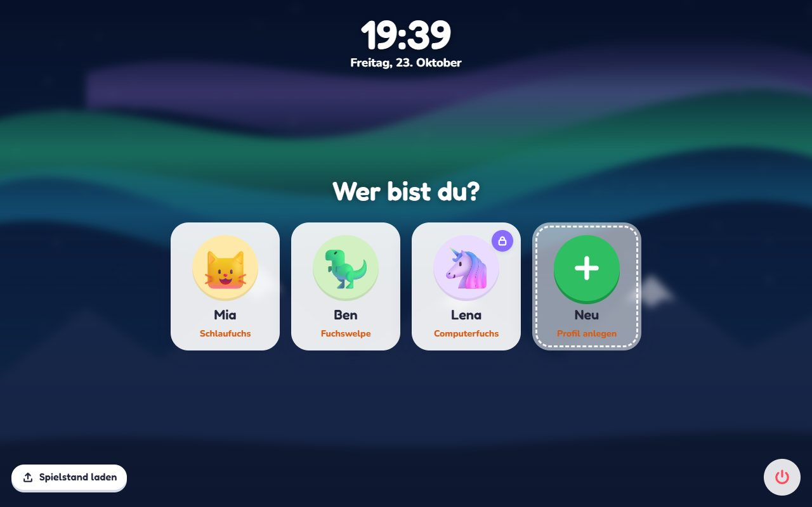<br><b>Anmeldung:</b> Jedes Kind hat ein Profil – auf Wunsch mit Geheimcode.</td>
    <td width="50%">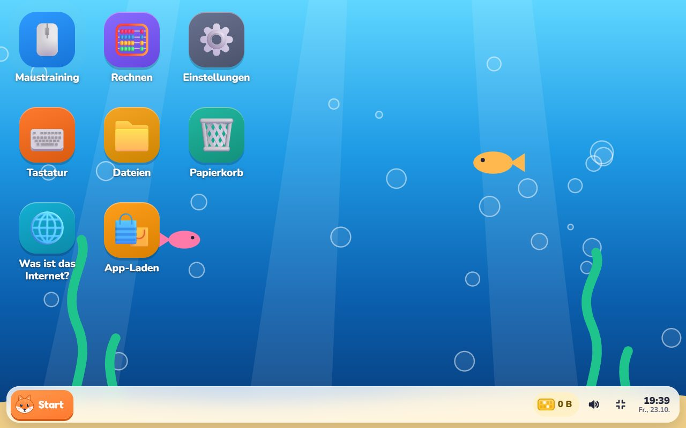<br><b>Mit 5 Jahren:</b> große Symbole, ein Klick genügt. Den Rest schaltet das Maustraining frei.</td>
  </tr>
  <tr>
    <td width="50%">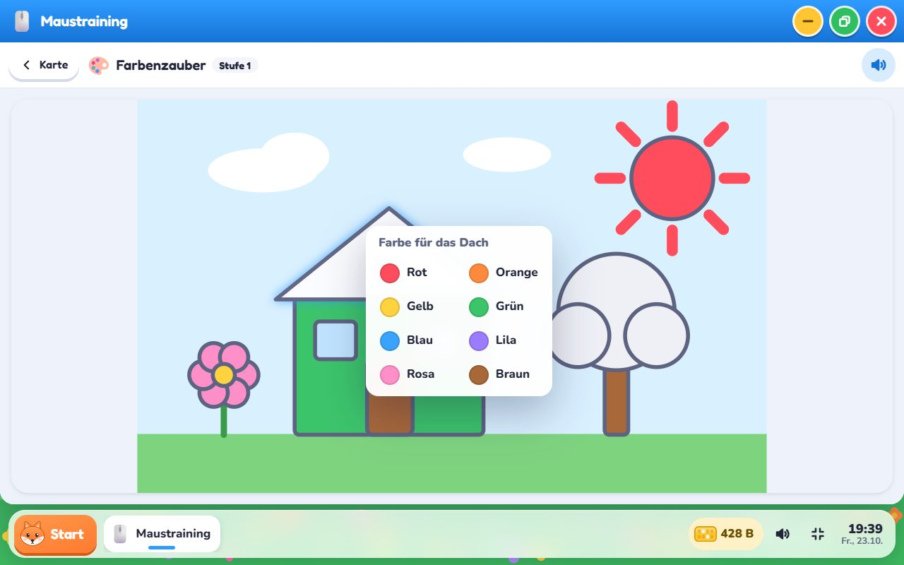<br><b>Maustraining:</b> Im Farbenzauber malt der Rechtsklick.</td>
    <td width="50%">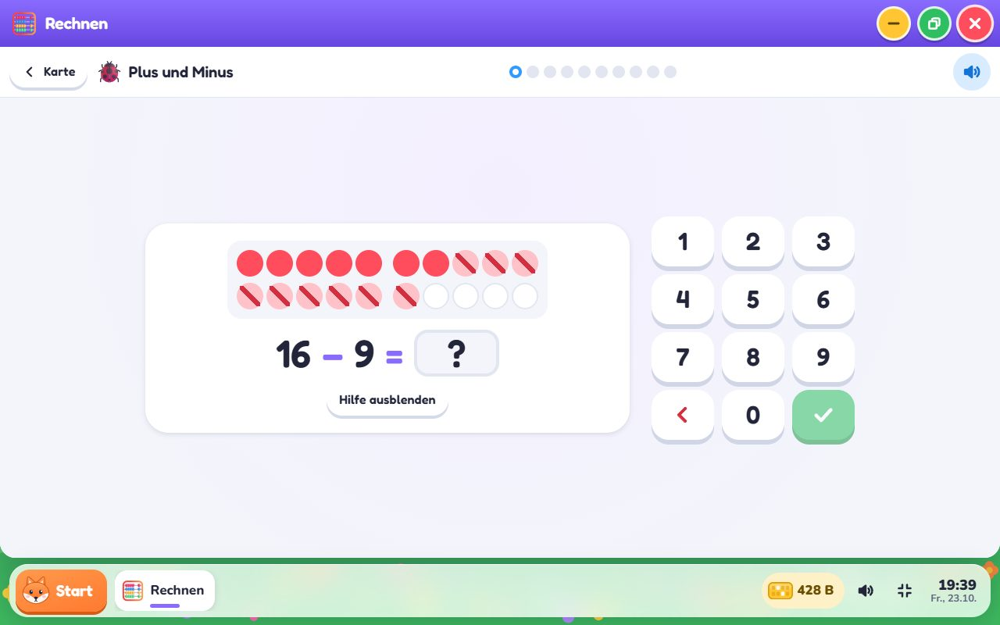<br><b>Rechnen:</b> Plus und Minus bis 20, das Zwanzigerfeld hilft.</td>
  </tr>
  <tr>
    <td width="50%">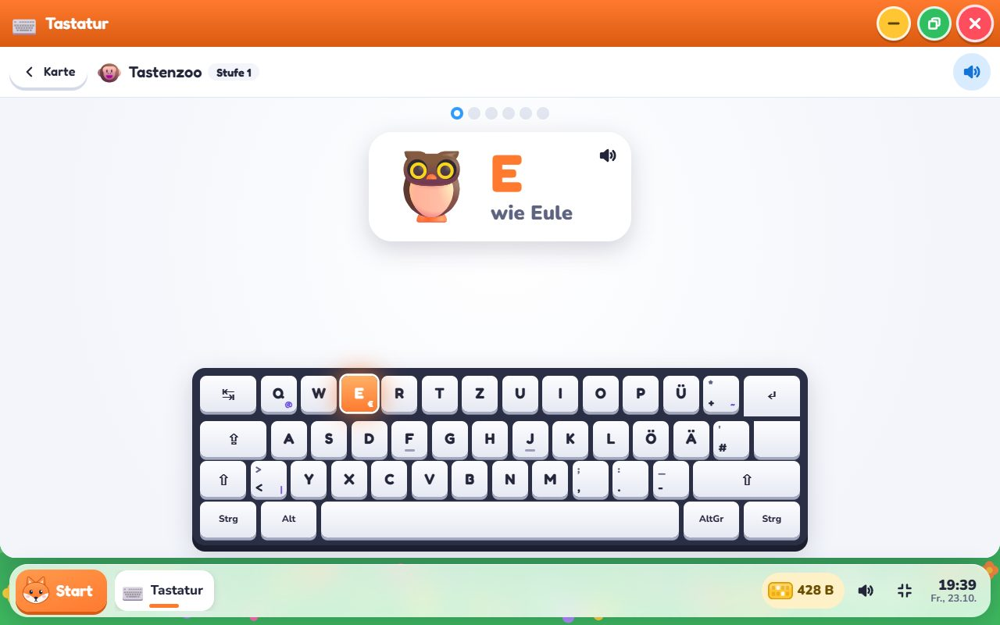<br><b>Tastatur:</b> Im Tastenzoo leuchtet die gesuchte Taste – T wie Tulpe.</td>
    <td width="50%">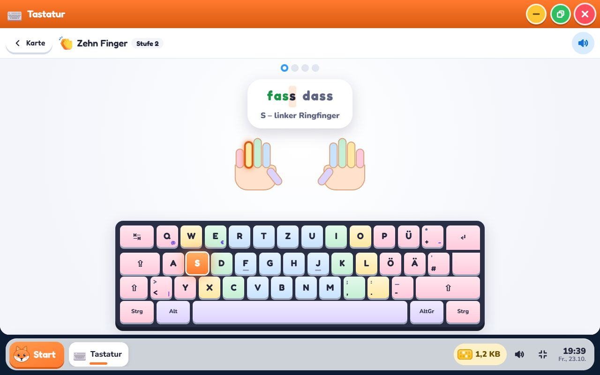<br><b>Zehn Finger:</b> Jeder Finger hat seine Farbe.</td>
  </tr>
  <tr>
    <td width="50%">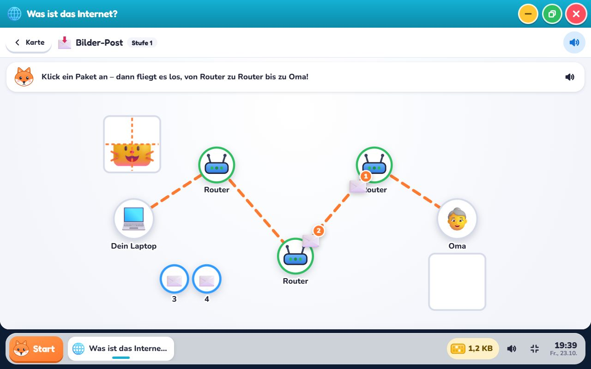<br><b>Was ist das Internet?</b> Ein Foto reist in vier Paketen zu Oma, von Router zu Router.</td>
    <td width="50%">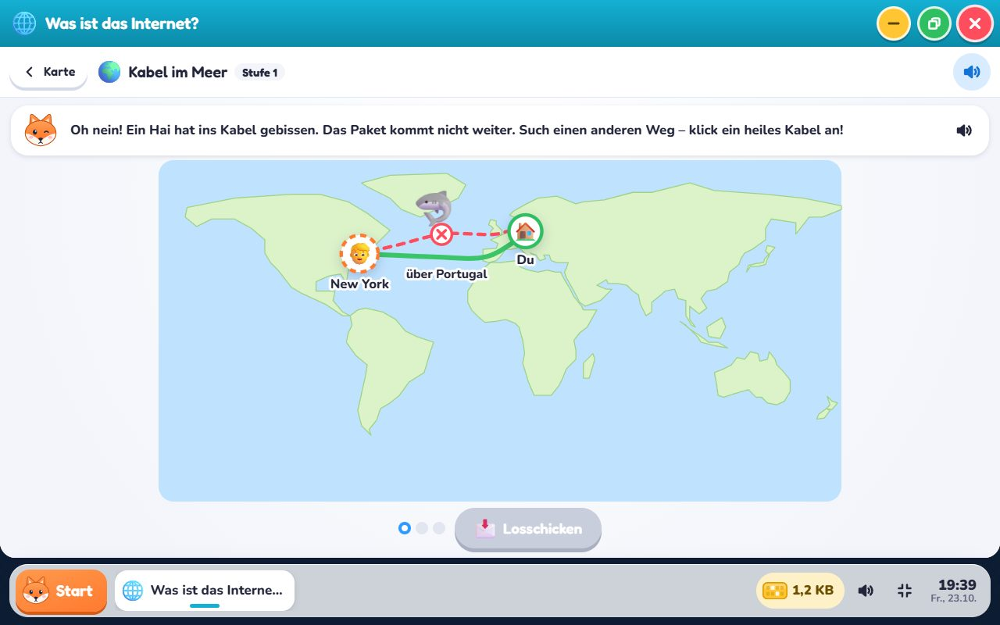<br><b>Kabel im Meer:</b> Ein Hai hat ins Kabel gebissen – das Foto braucht einen anderen Weg.</td>
  </tr>
  <tr>
    <td width="50%">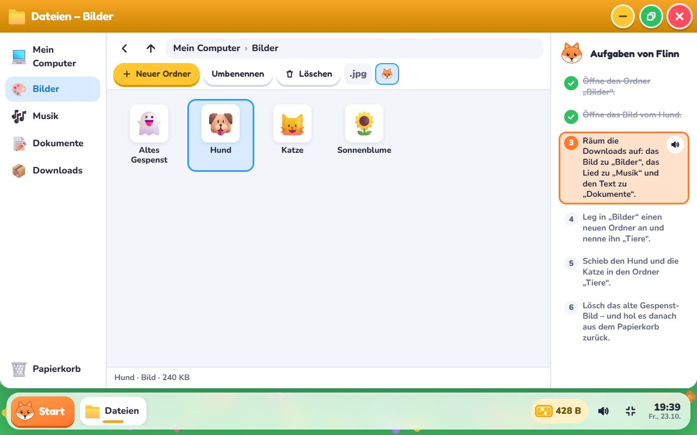<br><b>Dateien:</b> Ordner, Ziehen und Ablegen, Papierkorb – mit Flinns Aufgaben.</td>
    <td width="50%">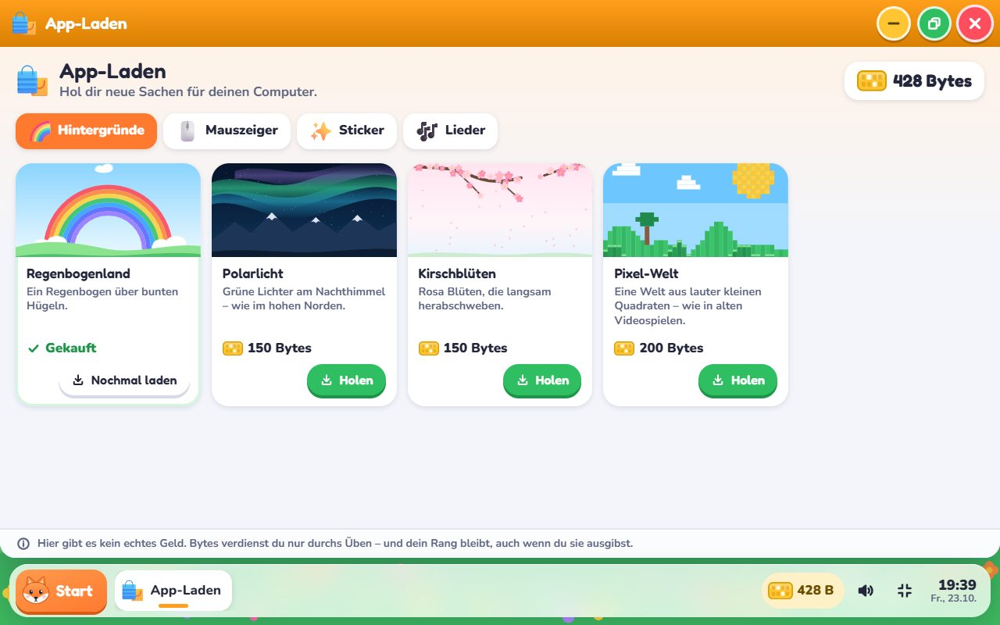<br><b>App-Laden:</b> Bytes gegen Hintergründe, Mauszeiger, Sticker und Lieder.</td>
  </tr>
</table>

## Was es kann

- **Ein Desktop, der mitwächst.** Vier Desktop-Funktionen gibt es nicht
  geschenkt, man verdient sie im Maustraining: Öffnen per Doppelklick, Fenster
  verschieben, Rechtsklick-Menü sowie verkleinern, vergrößern und Größe ändern.
  Flinn, der Fuchs, kündigt jede an und lässt sie gleich ausprobieren. Mit 7 bis
  9 Jahren sind die ersten beiden schon da, ab 10 alle. Eltern können jede
  einzeln an- und ausschalten.
- **Maustraining, 8 Level mit je 3 Stufen.**
  - Taschenlampe: versteckte Tiere im Dunkeln suchen.
  - Ballons: zum Platzen anklicken, auf Stufe 3 nur die roten.
  - Geschenke: per Doppelklick öffnen. Mit jeder Stufe bleibt weniger Zeit
    zwischen den zwei Klicks.
  - Tiere füttern: das richtige Essen zum richtigen Tier ziehen.
  - Bienenweg: einen Weg nachfahren, mit Zwischenstationen nach einem Ausrutscher.
  - Farbenzauber: ein Bild per Rechtsklick-Menü ausmalen. Auf Stufe 2 nach
    Vorlage, auf Stufe 3 mit Untermenü.
  - Tauchgang: durch ein Meer scrollen.
  - Fenster-Profi: ein Fenster verschieben, größer ziehen, verkleinern,
    zurückholen, vergrößern und schließen.
- **Tastatur, 7 Level mit je 3 Stufen,** mit einer Bildschirmtastatur im
  deutschen Layout (QWERTZ):
  - Tastenzoo: zum Bild die Taste mit dem Anfangsbuchstaben finden („A wie
    Affe“), auf Stufe 3 nur nach Gehör.
  - Hüpfhase: mit der Leertaste über Igel springen.
  - Hamsterweg: mit den Pfeiltasten durchs Labyrinth, auf Stufe 3 Kekse sammeln.
  - Sternenregen: fallende Buchstaben fangen, bevor sie landen.
  - Bilderwörter: das Wort zum Bild schreiben, später mit Rücktaste und
    Großbuchstaben.
  - Zehn Finger: die Grundstellung, jede Taste in der Farbe ihres Fingers.
  - Tipp-Profi: Umschalttaste, Satzzeichen, das @ (AltGr+Q) und ein Wettrennen
    gegen Flinn, gemessen in Anschlägen pro Minute.
- **Rechnen, 6 Level.** Zählen bis 10, Plus und Minus bis 10, bis 20 (meist mit
  Zehnerübergang, das Zwanzigerfeld hilft auf Wunsch), Einmaleins und
  Kopfrechnen bis 100. Jede Runde wird neu erzeugt. Kleine Mengen stehen in
  Fünferreihen, wie in der Grundschule. Die Antwort geht über ein Zahlenfeld oder
  die echte Tastatur. Nach einem Fehler gibt es einen zweiten Versuch und ein
  Bild zur Aufgabe.
- **„Was ist das Internet?“, 5 Kapitel × 3 Stufen,** je eine für 5 bis 7, 8 bis
  10 und ab 11 Jahren. Die Kinder bauen und benutzen ein Netz, statt darüber zu
  lesen:
  - Das Netz: Laptop, Computer und Fernseher am Router einstecken (das Handy
    funkt per WLAN), die Kabel bis zu Oma über beide Internetanbieter ziehen und
    sechs Städte so verbinden, dass kein gerissenes Kabel eine Stadt
    abschneidet. Ein Traktor prüft jedes Kabel.
  - Bilder-Post: Ein Foto reist in vier Paketen. Router lesen die Adresse und
    geben jedes Paket weiter, so wie es ihr Wegweiser sagt. Nummerierte Pakete
    kommen durcheinander an, und ein verlorenes wird einfach nachgefordert.
  - Kabel im Meer: Ein Hai beißt ein Seekabel durch, und das Foto nimmt einen
    anderen Weg. Zwei Wege liefern sich ein Rennen mit Lichtgeschwindigkeit im
    Glasfaserkabel. Ein echter Ping zum Server, verglichen mit Paris, Tokio und
    dem Mond.
  - Das Telefonbuch: Namen werden zu Nummern (DNS). Das Bild im Telefonbuch
    finden, eine Adresse eintippen (ein Tippfehler wird erklärt) und
    herausfinden, wem eine Adresse wirklich gehört.
  - Das Schloss: Postkarte oder Schatzkiste, vorbei an einem neugierigen
    Waschbären; eine Geheimschrift mit dem Caesar-Streifen; und würdest du hier
    dein Passwort eingeben – ist das Schloss da, und wem gehört die Adresse?
- **Dateien mit Papierkorb.** Jedes Kind hat ein eigenes kleines Dateisystem mit
  Bildern, Musik, Dokumenten und Downloads. Es legt Ordner an, benennt um (mit
  denselben Regeln wie unter Windows), zieht Dateien in Ordner, kopiert und fügt
  ein – mit Maus, Rechtsklick oder Entf, F2 und Strg+C/V. Gelöschtes landet im
  Papierkorb und lässt sich zurückholen. Dateiendungen wie `.jpg` lassen sich
  einblenden. Flinn stellt sechs Aufgaben, vom ersten Ordner bis zum Aufräumen
  der Downloads. Bilder, Lieder und Texte öffnen sich in einer eigenen Anzeige.
- **App-Laden.** Mit den Bytes gibt es Hintergründe, Mauszeiger in anderen
  Farben, Sticker für den Desktop und Lieder. Was man holt, landet als Datei im
  Ordner „Downloads“. Wer es dort öffnet und als Hintergrund festlegt, übt
  nebenbei den Umgang mit Dateien. Echtes Geld gibt es nicht, und der Rang sinkt
  beim Ausgeben nicht.
- **Gemacht für Kinder, die noch nicht lesen.** Jede Anleitung hat ein Bild und
  kann vorgelesen werden (Sprachausgabe des Browsers). Knöpfe und Ziele sind
  groß, und Zeitdruck gibt es nur, wo Tempo das Lernziel ist. Den Mauszeiger gibt
  es in Normal, Groß und Riesig.
- **Bytes statt Münzen.** Jeder neue Stern bringt Bytes. Die gesammelten Bytes
  bestimmen den Rang: Fuchswelpe, Jungfuchs, Schlaufuchs, ab 1 Kilobyte
  Computerfuchs und danach Meisterfuchs.
- **Profile mit Geheimcode.** Jedes Kind wählt ein Tier, einen Namen und sein
  Alter. Wer mag, schützt sein Profil mit vier Bildern oder vier Zahlen – das
  erste eigene Passwort. Hat ein Kind den Code vergessen, setzen Erwachsene ihn
  zurück. Das Alter ändern nur Erwachsene, denn es bestimmt, wie viel der Desktop
  kann.
- **Gespeichert im Browser, gesichert als Datei.** Der Fortschritt liegt lokal.
  Ein Erwachsenen-Bereich hinter einer kleinen Rechenaufgabe sichert alle Profile
  als JSON-Datei und lädt sie wieder, per Knopf oder per Ziehen auf den
  Anmeldebildschirm. Kaputte oder fremde Dateien werden mit einer Erklärung
  abgelehnt, statt die Seite abstürzen zu lassen.
- **Läuft auch offline und als App.** Nach dem ersten Besuch liegt Computerfuchs
  im Offline-Speicher des Browsers und startet auch ohne Internet. Chrome und
  Edge installieren es als App mit eigenem Symbol und Fenster (ein Knopf dafür
  steht im Erwachsenen-Bereich).
- **Kiosk-tauglich.** Mit `?kiosk` am Ende der Adresse verschwindet der
  Vollbild-Knopf, und „Ausschalten“ führt zurück zum Einschaltknopf. Zwei
  Skripte machen einen Rechner zum festen Lerncomputer: eines für Linux mit Cage
  (auch auf dem Raspberry Pi), eines für Windows. Die
  [Anleitung](docs/KIOSK.de.md) beschreibt alle drei Wege.
- Deutsch zuerst. Keine Anmeldung, keine Werbung, keine Cookies, keine Analyse
  und keine Anfragen an fremde Server: Schriften und Bilder kommen vom selben
  Server wie die Seite.

## Mit Kindern ausprobieren

Rückmeldungen von echten Kindern sind das Wertvollste für Computerfuchs. Die
[Testanleitung](docs/TESTING.de.md) zeigt, wie ein kurzer Test je nach Alter
abläuft und worauf man achtet. Sie hat auch einen Beobachtungsbogen zum
Ausdrucken.

## Entwickeln

```sh
npm ci
npm run dev        # http://localhost:5173
npm test           # Vitest (Logik: Profile, Belohnung, Spielstand, Fenster, Rechnen, Dateien, Tastatur, Netze)
npm run lint       # oxlint
npm run build      # Typprüfung + Produktions-Build nach dist/
npm run preview    # dist/ unter http://localhost:4173 ausliefern
npm run e2e        # Durchlauf im Browser gegen die Vorschau (nutzt einen installierten Chrome/Edge)
npm run screenshots  # die Bilder fürs README neu aufnehmen (docs/images/), ebenfalls gegen die Vorschau
```

`npm run e2e` spielt in einem unsichtbaren Chrome die ganze App durch: alle acht
Maus-Level, alle sieben Tastatur-Level und alle 15 Stufen von „Was ist das
Internet?“, Rechnen, Flinns Dateien-Aufgaben, einen Kauf im App-Laden, Sticker,
ein Lied, den Geheimcode, die Einstellungen, die Spielstand-Datei, ein Neuladen,
ein zweites Profil, den Kiosk-Modus und einen Neustart ohne Internet. Er schlägt
fehl, sobald in der Konsole ein Fehler auftaucht. Mit einer Adresse prüft er die
Live-Seite: `npm run e2e -- https://technikweber.github.io/Computerfuchs/`.
Screenshots landen in `test-results/e2e/`.

Stack: React 19, TypeScript 7, Vite 8, Vitest und oxlint, genau wie
[LinuxKompass](https://github.com/TechnikWeber/LinuxKompass) und
[JobKompass](https://github.com/TechnikWeber/JobKompass). Jeder Push auf `main`
wird von `.github/workflows/deploy.yml` geprüft, gebaut und auf GitHub Pages
veröffentlicht. Der Build nutzt einen relativen Pfad. Deshalb läuft `dist/` auch
auf einem Schulserver oder als lokale Kopie.

Aufbau:

- `src/core/`: Profile, Belohnung, Spielstand, Dateisystem, App-Laden, Geheimcode, Lieder, Ton, Sprache, kleine Hooks
- `src/os/`: der simulierte Computer mit Start, Anmeldung, Desktop, Fenstern, Taskleiste, Stickern und Mauszeigern
- `src/apps/`: die Apps. `registry.ts` listet sie auf; Apps mit „bald“ stehen schon im Start-Menü.
- `tools/`: der Offline-Speicher (Service Worker), der beim Bauen entsteht, und das Skript für die README-Bilder
- `kiosk/`: die Kiosk-Skripte für Linux und Windows

## Lizenz

Code: MIT (siehe `LICENSE`). Bilder: Fluent Emoji von Microsoft (MIT).
Schriften: Nunito und Fredoka (SIL OFL). Die Lieder sind traditionelle,
gemeinfreie Kinderlieder. Einzelheiten stehen in `THIRD_PARTY_NOTICES.md`.
